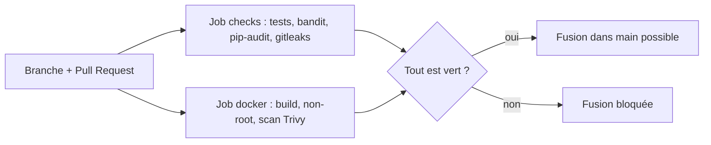
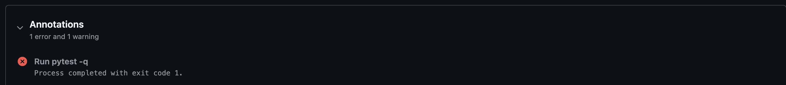
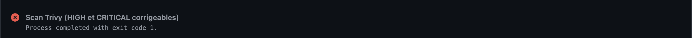

# Pipeline CI/CD sécurisé : démonstrateur

Une petite API d'inventaire (Flask + SQLite) dont **le vrai sujet est la chaîne qui l'entoure** : comment garantir que seul du code contrôlé aboutisse à l'image qui sera déployée.

L'application est volontairement banale. Chaque choix de sécurité est détaillé dans [SECURITY.md](SECURITY.md) et relié au contrôle automatique qui le fait respecter.

## La chaîne en un coup d'œil



## Preuves

**1. Une Pull Request qui casse un test ne peut pas être fusionnée.**


**2. Le scan d'image a bloqué un build, puis laissé passer sa version corrigée.**
Trivy a signalé 5 failles HIGH corrigeables dans des bibliothèques embarquées par pip. La correction a consisté à retirer pip de l'image finale (il ne sert qu'à l'installation), ce qui a supprimé les 5 alertes et réduit la surface d'attaque.


**3. Un push direct sur `main` est refusé** : seules les Pull Requests avec contrôles verts sont acceptées.

## Contenu

| Élément | Détail |
|---|---|
| API | `GET /health`, `GET /items`, `POST /items` : entrées validées strictement, requêtes SQL paramétrées |
| Tests | 8 tests `pytest`, dont un qui vérifie qu'une tentative d'injection SQL reste inerte |
| CI | tests, `bandit` (analyse statique), `pip-audit` (dépendances), `gitleaks` (secrets), build d'image, scan `Trivy` |
| Image | `python:3.14-slim`, utilisateur non-root (UID 10001), pip retiré, seul `/data` accessible en écriture, healthcheck |
| Chaîne d'approvisionnement | versions Python figées (`pip-compile`), actions GitHub épinglées par SHA de commit, Dependabot hebdomadaire |
| Dépôt | `main` protégée : Pull Request et contrôles obligatoires, force-push interdit |

## Lancer le projet

```bash
python3 -m venv .venv && source .venv/bin/activate
pip install -r requirements.txt -r requirements-dev.txt
pytest -q
```

Avec Docker (le port n'est publié que sur la machine locale) :

```bash
docker build -t demo .
docker run --rm -p 127.0.0.1:8000:8000 demo
curl localhost:8000/health
```

## Limites connues

- L'API n'a **aucune authentification** : c'est un démonstrateur de chaîne, pas un service à exposer.
- Les versions Python sont figées, mais **sans vérification d'empreintes** (`--generate-hashes`).
- L'image de base est référencée par étiquette, pas par empreinte (Dependabot la tient à jour).
- Pas encore de SBOM ni de signature d'image.

## Prochaine étape

Déploiement automatisé depuis GitHub Actions vers un serveur, par SSH avec une clé limitée à une seule commande, sans aucun point d'entrée public.